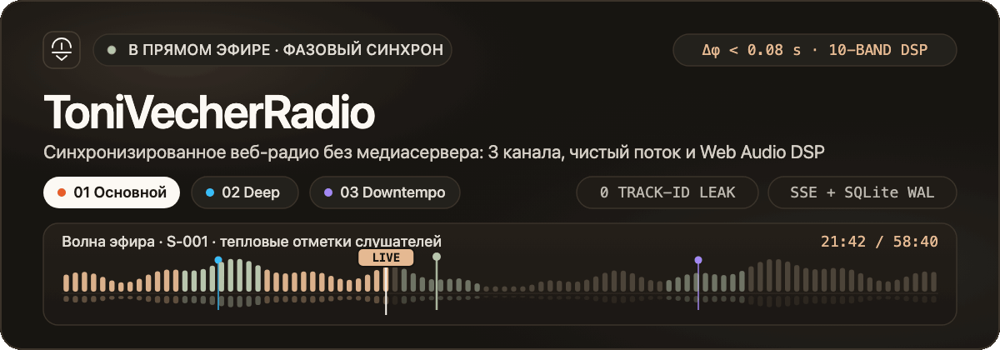
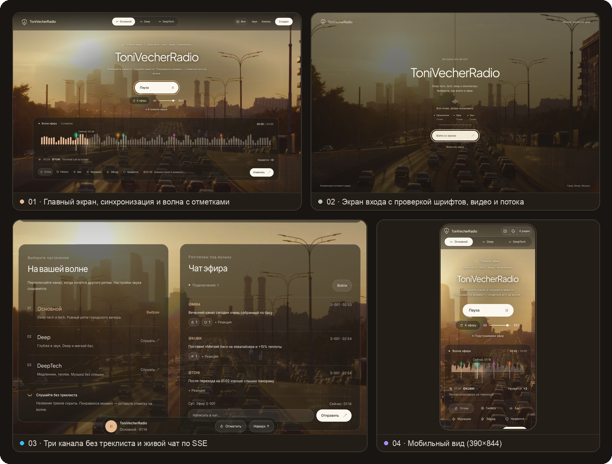
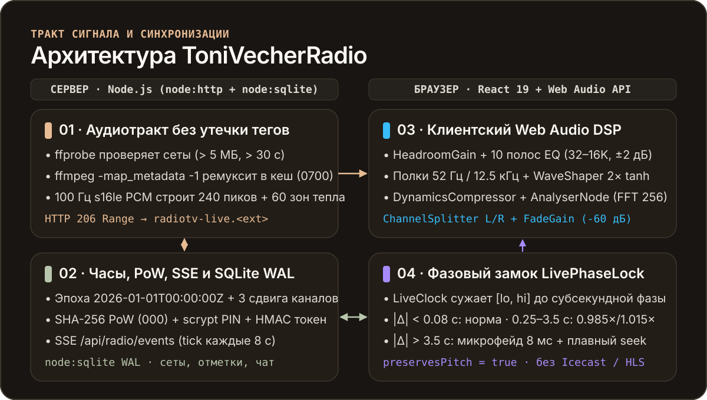

<p align="center">
  
</p>

<p align="center">
  Синхронизированное онлайн-радио на три канала с общим временем эфира, очисткой тегов на лету и 10-полосным Web Audio эквалайзером.
</p>

<p align="center">
  <a href="https://radio.tonivecher.online"><strong>Прямой эфир</strong></a> ·
  <a href="#интерфейс">Интерфейс</a> ·
  <a href="#архитектура-и-тракт-сигнала">Архитектура</a> ·
  <a href="#быстрый-старт">Быстрый старт</a> ·
  <a href="#http-и-sse-api">API</a> ·
  <a href="#тесты">Тесты</a>
</p>

---

## Интерфейс

Экран входа проверяет готовность шрифтов, фонового видео и аудиопотока до запуска звука. После входа слушатель сразу попадает на волну текущего сета с отметками моментов, консолью эквалайзера и чатом канала.

<p align="center">
  
</p>

В секции настройки звука работают 10 полос от `32 Гц` до `16 кГц` (`±2 дБ`), четыре макро-регулятора (`Бас`, `Теплота`, `Воздух`, `Компрессия`), шесть встроенных профилей и 32-полосный анализатор спектра со стерео-индикатором уровня.

<p align="center">
  
</p>

## Как работает радио

**Единая фаза эфира без Icecast и HLS.** Сервер считает активный сет и позицию в нём детерминированно от фиксированной эпохи `2026-01-01T00:00:00Z` с разными сдвигами для трёх каналов (`Основной`, `Deep`, `Downtempo`). На клиенте `LiveClock` сужает целые секунды сервера до субсекундной оценки, а `LivePhaseLock` удерживает `<audio>` в общей фазе: при дрейфе до `0.08 с` ничего не трогает, на интервале `0.25–3.5 с` мягко сдвигает скорость в пределах `0.985×–1.015×` с сохранением высоты тона (`preservesPitch`), а при расхождении больше `3.5 с` глушит выход до `-60 дБ` на `8 мс`, переставляет позицию и возвращает звук за `40 мс`.

**Слепое прослушивание без утечки названий.** Оригинальные файлы на диске открываются только на чтение. При первом запросе потока `server/media.mjs` пересобирает аудио в кеш с правами `0700` через `ffmpeg -map_metadata -1 -map_chapters -1`, убирает ID3-теги, переносит индекс `.m4a` в начало (`+faststart`), проверяет результат через `ffprobe` и отдаёт с анонимным именем `radiotv-live.<ext>` по HTTP `206 Partial Content`.

**Волна и тепловая карта на сервере.** Фоновая очередь в `server/waveform.mjs` декодирует аудио в моно `100 Гц s16le` PCM и сжимает его в 240 нормализованных пиков (`[0.08..1.0]`). Поверх этой сетки рассчитывается 60-сегментная карта плотности реакций.

**Вход по Proof-of-Work и чат через SSE.** Авторизация обходится без сторонних OAuth-провайдеров и почтовых сервисов: клиент решает `SHA-256` задачу со сложностью `3` нуля в начале хеша, после чего может зайти гостем или закрепить позывной шестизначным PIN-кодом (хеш `crypto.scryptSync`, сессия в `HMAC-SHA256` токене). Сообщения, реакции и отметки на волне хранятся в `node:sqlite` (`WAL`) и расходятся по активным вкладкам через `/api/radio/events`.

## Архитектура и тракт сигнала

<p align="center">
  
</p>

- **Сервер (`server/`)** написан на чистом Node.js (`v26.5.0`) без внешних npm-зависимостей в рантайме. Использует встроенные `node:http`, `node:sqlite`, `node:crypto` и вызовы `ffmpeg`/`ffprobe`.
- **Клиент (`src/`)** собран на React 19, TypeScript 5.7, Vite 6 и Tailwind CSS 4. Вся обработка звука (`src/audio/dspEngine.ts`) остаётся на стороне браузера и включает автоматический расчёт запаса по громкости (`HeadroomGain`) перед сатуратором `WaveShaper` и компрессором.

<details>
<summary>Структура каталогов проекта</summary>

| Путь | Назначение |
| --- | --- |
| `index.html` | HTML-оболочка и стартовая разметка |
| `src/` | Клиент: `audio/`, `components/`, `constants/`, `hooks/`, `styles/`, `types/`, `utils/` |
| `public/` | Статика: иконки и манифест (`brand/`), локальные шрифты (`fonts/`), фон (`media/`) |
| `server/` | HTTP/SSE-сервер (`index.mjs`), SQLite-слой (`db.mjs`), медиа-кеш (`media.mjs`), волна (`waveform.mjs`), защита (`security.mjs`), статика (`static.mjs`) |
| `tests/` | Раннер (`run.mjs`), серверные тесты (`regression.mjs`), Playwright-проверки (`browser.mjs`) и smoke-тест стенда (`public-smoke.mjs`) |
| `assets/readme/` | Исходные SVG-диаграммы (`hero.svg`, `architecture.svg`), скриншоты и GIF для документации |

</details>

## Быстрый старт

Понадобятся Node.js 26+ (с поддержкой `node:sqlite`), а также `ffmpeg` и `ffprobe` в `PATH`, `/opt/homebrew/bin` или `/usr/local/bin`.

1. Установите зависимости и соберите фронтенд в `dist/`:

```bash
npm install
npm run build
```

2. Положите аудиофайлы (`.m4a`, `.mp3`, `.flac`, `.wav`, `.aiff`, `.ogg`, размером от `5 МБ` и длительностью от `30 с`) в `server/sets/` или укажите путь через `RADIOTV_SETS_DIRS`.

3. Запустите сервер с локальным каталогом кеша:

```bash
RADIOTV_AUDIO_CACHE=./server/cache npm start
```

Приложение откроется на `http://127.0.0.1:4321`.

Для разработки фронтенда с HMR держите сервер запущенным в первом терминале, а во втором поднимите Vite на порту `5173` (прокси `/api` смотрит на `http://127.0.0.1:4321`):

```bash
npm run dev
```

### Основные команды

| Команда | Действие |
| --- | --- |
| `npm start` | Запуск HTTP/SSE-сервера и раздача собранного `dist/` |
| `npm run server` | Алиас для `node server/index.mjs` |
| `npm run dev` | Запуск Vite dev-сервера на порту `5173` |
| `npm run typecheck` | Проверка типов TypeScript (`tsc --noEmit`) |
| `npm run build` | Проверка типов и сборка фронтенда в `dist/` |
| `npm test` | Полный прогон `tests/run.mjs` во временной директории |

### Переменные окружения

Готовый шаблон лежит в [`.env.example`](./.env.example).

| Переменная | По умолчанию | Назначение |
| --- | --- | --- |
| `PORT` | `4321` | Порт HTTP-сервера |
| `RADIOTV_HOST` | `127.0.0.1` | Интерфейс, на котором сервер принимает подключения |
| `RADIOTV_DATA_DIR` | `./server` | Каталог с базой `radiotv.sqlite` и подкаталогом `sets/` |
| `RADIOTV_SETS_DIRS` | `<RADIOTV_DATA_DIR>/sets` | Каталоги с аудиосетами через `:` (на Windows `;`) |
| `RADIOTV_AUDIO_CACHE` | `/var/cache/radiotv/audio` | Каталог кеша пересобранных аудиофайлов без метаданных |
| `RADIOTV_SECRET` | из `server/.secret` | Ключ подписи токенов (от 32 символов); при отсутствии генерируется в `server/.secret` |
| `RADIOTV_TRUSTED_PROXIES` | пусто | Доверенные IP прокси через запятую для разбора `X-Forwarded-For` |
| `RADIOTV_PREVIEW_API` | пусто | Прокси `/api` для `vite dev`; включает read-only режим (блокирует мутирующие методы) |

## HTTP и SSE API

| Метод и путь | Назначение |
| --- | --- |
| `GET /api/health` | Статус сервиса, число проиндексированных сетов и список каналов |
| `GET /api/radio/state?channel=ch-main` | Полное состояние канала: активный сет, расписание, 240 пиков волны, тепловая карта, отметки и 50 последних сообщений |
| `GET /api/radio/channels` | Сводка по трём каналам (`ch-main`, `ch-deep`, `ch-afterglow`) и счётчик подключений |
| `GET /api/radio/events?channel=ch-main` | Поток `Server-Sent Events` (`connected`, `broadcast:tick` каждые 8 с, `moment:*`, `chat:*`, `listeners:update`) |
| `GET /api/radio/stream/:channel` | Стриминг текущего сета канала с поддержкой `Range` (`206 Partial Content`) |
| `GET /api/radio/stream-set/:setId` | Стриминг конкретного сета (используется для предзагрузки следующего слота) |
| `GET /api/radio/archive` | Список доступных сетов без внутренних путей и имён файлов |
| `GET /api/auth/challenge` | Выдача подписанного HMAC `SHA-256 PoW` челленджа (`difficulty = 3`) и палитры аватаров |
| `POST /api/auth/login` | Вход или регистрация позывного с PIN-кодом (6–16 цифр) после проверки PoW |
| `POST /api/auth/guest` | Быстрый гостевой вход с автоматически сгенерированным позывным |
| `GET /api/auth/me` | Проверка текущей сессии по `Bearer`, `X-Auth-Token` или `X-Session-Token` |
| `POST /api/radio/moments` | Добавление отметки реакции на таймкод волны (требуется токен) |
| `POST /api/radio/moments/:id/react` | Лайк отметки на волне |
| `POST /api/radio/chat` | Отправка сообщения в чат канала (ограничение частоты 1.5 с и антиспам) |
| `POST /api/radio/chat/:id/react` | Добавление или снятие реакции на сообщении в чате |

## Тесты

```bash
npm test
```

Скрипт `tests/run.mjs` проверяет свежесть `dist/`, генерирует три тестовых WAV-файла во временном каталоге ОС с канареечными метаданными, поднимает изолированный сервер на случайном порту и выполняет `node --test tests/regression.mjs`. Если в окружении доступен `playwright` или задана переменная `PLAYWRIGHT_MODULE_PATH`, запускается браузерная проверка `tests/browser.mjs` (с флагом `--with-browser` отсутствие Playwright считается ошибкой). Временные файлы удаляются автоматически.

Для проверки развёрнутого стенда предусмотрен отдельный скрипт:

```bash
node tests/public-smoke.mjs
```
